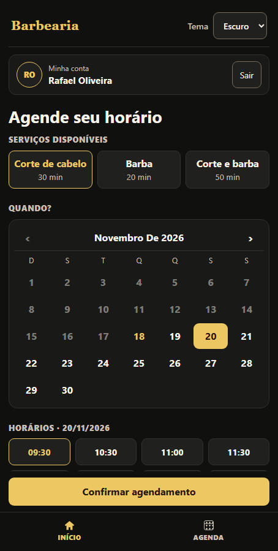
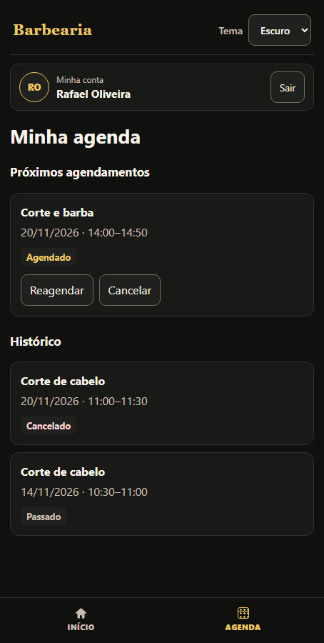
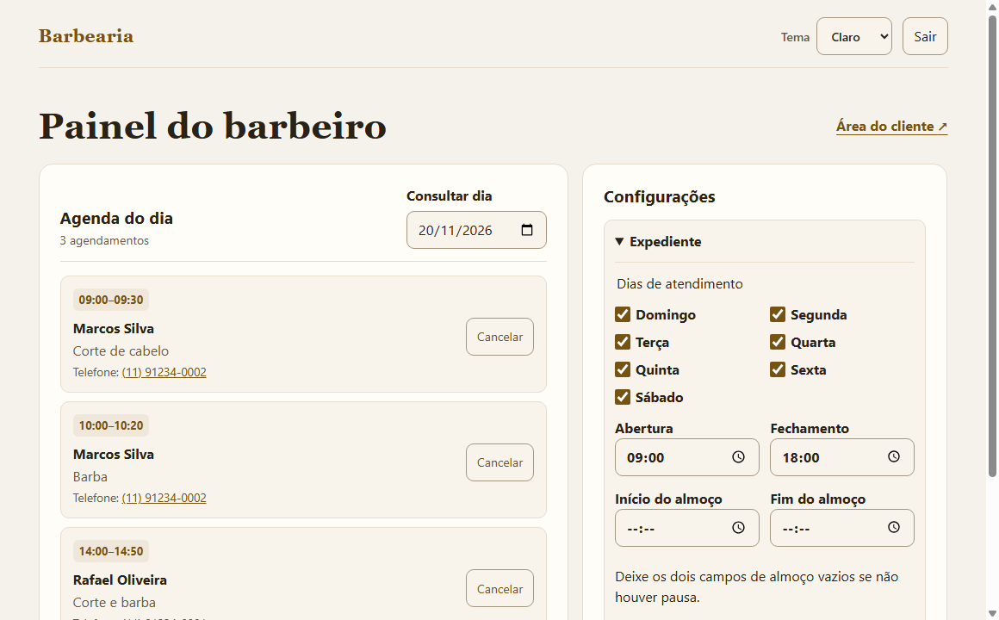

# Agendamento de Barbearia

Sistema de agendamento com uma área para clientes e um painel administrativo
para o barbeiro. O cadastro de contas, as reservas, o catálogo de serviços e
o expediente são salvos no SQLite.

## Funcionalidades

### Área do cliente

- Cadastro com nome completo, telefone com DDD e senha. A entrada usa telefone e senha.
- Escolha de serviço, data em calendário e horário disponível. O preço aparece quando cadastrado.
- Aba **Minha agenda** com **Próximos agendamentos** em ordem de horário e **Histórico** de reservas passadas ou canceladas.
- Cancelamento e reagendamento de reservas futuras pela própria conta. O reagendamento mantém a duração do serviço e libera o horário anterior.

### Painel do barbeiro

- Acesso com a senha definida em `BARBEIRO_SENHA`.
- Agenda por data, com nome do cliente, serviço, horário e telefone quando disponível.
- Cancelamento com liberação do horário e registro no histórico do cliente.
- Configuração dos dias de atendimento, da abertura, do fechamento e da pausa para almoço.
- Cadastro e edição de serviços, com nome, duração e preço opcional.
- Aviso de reagendamento por WhatsApp quando a integração estiver configurada.

O sistema verifica o expediente, a duração do serviço e os conflitos antes de
salvar uma reserva. O agendamento e o painel oferecem temas claro e escuro.

## Capturas de tela

### Agendamento



### Minha agenda



### Painel do barbeiro



## Tecnologias

TypeScript, HTML, CSS, Node.js e SQLite.

## Como rodar

Use o Node.js 26, a versão usada para testar o projeto. Execute os comandos abaixo no PowerShell.

```powershell
npm.cmd install
$env:BARBEIRO_SENHA = 'escolha-sua-senha'
npm.cmd start
```

- [Área do cliente](http://127.0.0.1:3000/) — abre no login quando não há sessão ativa.
- [Cadastro de cliente](http://127.0.0.1:3000/cliente/cadastro)
- [Painel do barbeiro](http://127.0.0.1:3000/painel)

Substitua `escolha-sua-senha` pela senha que você quer usar no painel.
O comando `npm.cmd start` compila o TypeScript do navegador e inicia o servidor.
O SQLite cria o arquivo local `agenda.sqlite` na pasta do projeto.

## Avisos de reagendamento pelo WhatsApp

Configure um número remetente no WhatsApp Business Platform e um modelo aprovado pela Meta em português do Brasil (`pt_BR`). O corpo do modelo deve ter três parâmetros posicionais, nesta ordem: número da reserva, horário anterior e novo horário. Por exemplo:

> A reserva {{1}} foi reagendada. Horário anterior: {{2}}. Novo horário: {{3}}.

Antes de iniciar o servidor, defina as variáveis no PowerShell:

```powershell
$env:WHATSAPP_TOKEN = 'token-de-acesso-da-meta'
$env:WHATSAPP_PHONE_NUMBER_ID = 'id-do-numero-remetente'
$env:WHATSAPP_BARBEIRO_NUMERO = '5511987654321'
$env:WHATSAPP_TEMPLATE = 'reagendamento_barbearia'
# Opcional. Use uma versão da Graph API compatível com a conta.
$env:WHATSAPP_GRAPH_VERSION = 'v27.0'
npm.cmd start
```

Informe o número do barbeiro com código do país e DDD, usando apenas dígitos. Se estiver usando um número de teste da Meta, inclua o barbeiro entre os destinatários permitidos.

O reagendamento é salvo antes do envio. Com a integração configurada, os avisos entram numa fila no SQLite e o servidor tenta novamente após uma falha. O texto contém o número da reserva e os horários, sem o nome ou o telefone do cliente. Sem as credenciais, o cliente ainda consegue reagendar normalmente.

[Documentação do WhatsApp Business Platform](https://developers.facebook.com/documentation/business-messaging/whatsapp/overview)

## Teste manual

1. Crie uma conta de teste, entre e abra a área de agendamento em duas abas.
2. Nas duas abas, escolha o mesmo serviço, a mesma data e um horário livre. Confirme na primeira e tente confirmar na segunda sem recarregar. A segunda tentativa deve informar que o horário foi ocupado.
3. Em **Minha agenda → Próximos agendamentos**, clique em **Reagendar**, escolha outro horário e salve. O horário antigo deve ficar livre. Com a integração configurada, confira o aviso no celular do barbeiro.
4. Cancele a reserva pela conta do cliente. Ela deve aparecer no **Histórico** como **Cancelado**, e o último horário deve voltar à lista se ainda estiver dentro do expediente e no futuro.
